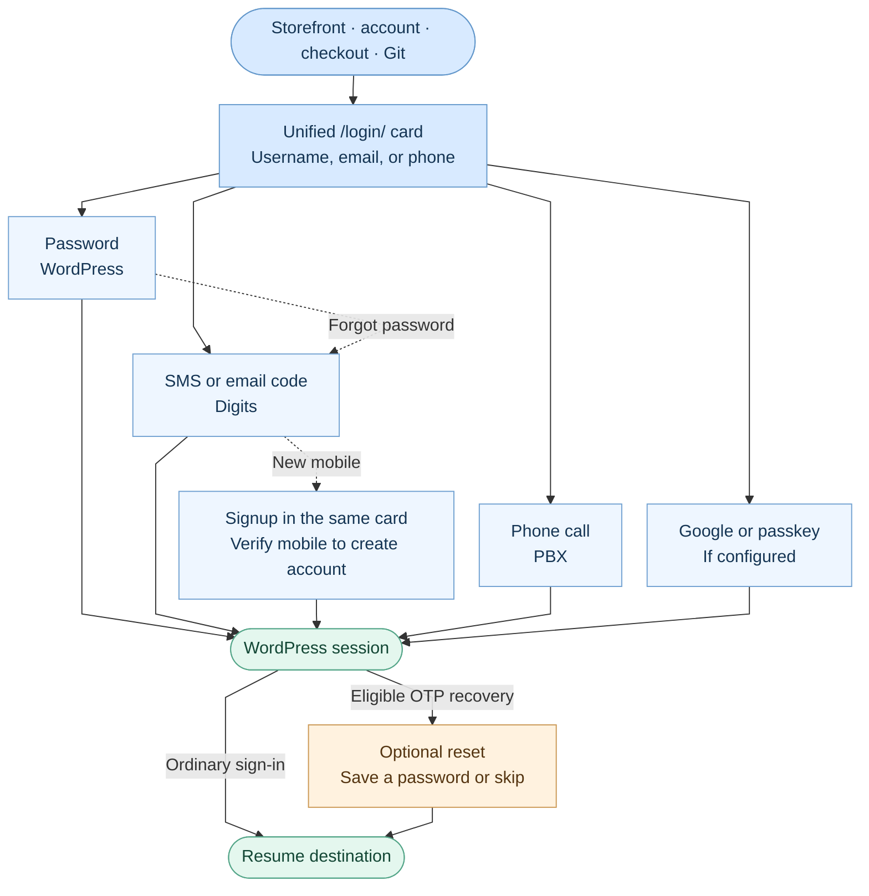
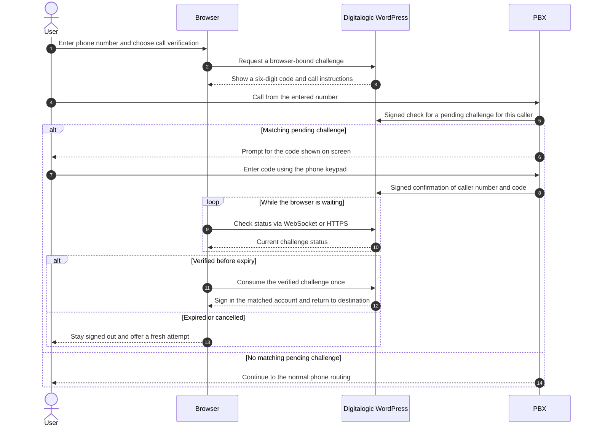
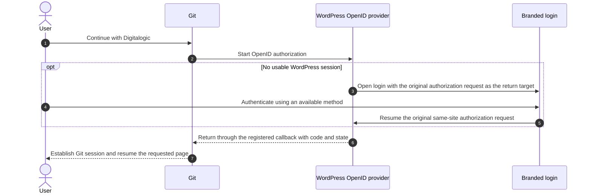

# Digitalogic authentication flow

Customers use one branded card at `/login/` for sign-in, mobile signup, and password recovery. The card routes users to the right method; WordPress, Digits, or the configured provider verifies the proof. The destination is carried through the flow so users can resume what they were doing.

## 1. From identity to a WordPress session

| What the user enters or chooses | What the card does next |
| --- | --- |
| Username or a validated email | Ask for the password. On the password screen, **Sign in without a password** switches to contact verification. |
| Mobile number | Ask Digits to send an SMS code. If Digits requests signup for a new mobile, the card carries the number into signup. |
| Fixed-line number | Show call instructions. If the numbering plan cannot distinguish fixed lines from mobiles, offer SMS and call when call verification is available. |
| Email or phone in recovery | Send an email code for a validated email, or use the applicable SMS or call route for the phone. Ask for the contact if it is missing. |
| Direct signup link | Open the same card; the configured Digits signup flow verifies the mobile before creating the account. |
| Google or passkey | Offer Google when configured. Keep passkey sign-in under **Other sign-in options** on the first step. |

- **Entry and identity.** Supported WordPress login GET links route to the branded page with the locale and return target intact; credential POSTs still use WordPress. Existing sessions can continue where the requesting app permits. A trusted office assignment or a previously remembered account can suggest an identity, but the user still has to authenticate and can enter a different identity.
- **Validation.** Email is normalized and checked for syntax and a mail-capable domain; a successful domain check does not verify the mailbox or reveal whether an account exists. Phone numbers are normalized against the selected country. With `+98` shown, `09` becomes `9` as the user types; `00` can still start an international number. The next action stays disabled until the input passes its checks.
- **SMS and email codes.** Digits sends and verifies the code. Both channels use the same digit editor. WebOTP, where supported, fills the SMS code and leaves submission to the user when **Remember me** is offered. A full paste moves focus to **Verify code**; an invalid or expired code shows one message and returns focus to the first digit. Resend stays disabled until the provider countdown ends. Network and server failures leave the entered code unmarked.
- **Passwordless and recovery.** A recovery link opens the same card in contact mode. The optional reset dialog requires a WordPress session issued after successful SMS or email verification and a recovery nonce. Saving or skipping continues to the destination. Call verification signs the user in through its own challenge flow; it does not grant the OTP password reset dialog.
- **Session and passkeys.** The branded password, code, and call sign-in steps offer **Remember me** on the final step. Successful sign-in does not force passkey enrollment. Users can manage passkeys in account settings when the provider supports it.
- **Related surfaces.** The Woodmart sidebar keeps its own Digits layout. It shares the site's authentication providers, while the diagrams describe the canonical branded page. WooCommerce REST credentials and other machine integrations are separate from customer sign-in.

## 2. Call verification

A call only signs in an eligible existing account after the browser consumes the verified challenge. A failed or expired challenge leaves the user signed out and allows a fresh attempt. Carrier support and server configuration determine which numbers can use this path. See [PBX call verification](PBX_CALL_VERIFICATION.md) for the integration details.

## 3. Returning to Git

For a Git sign-in, the login page returns to the **WordPress authorization request**, which then hands off to Git's registered callback. The plugin preserves the recognized same-site continuation if a Digits success response would otherwise send the browser to the storefront. Git's provider registration and server-side policy are managed separately from this plugin. For ordinary sign-ins, the flow returns to the allowed destination or the configured account or provider fallback.

## Where each piece lives

| Area | Source |
| --- | --- |
| Login routes, email checks, account hints, and recovery | [class-auth-page.php](../includes/integrations/class-auth-page.php) |
| Branded card, provider handoff, OTP editor, and return handling | [admin-branding.js](../assets/js/branding/admin-branding.js) |
| Passkey settings and presentation configuration | [class-admin-branding.php](../includes/integrations/class-admin-branding.php) |
| Browser and server sides of call verification | [call-verification.js](../assets/js/call-verification.js) · [class-call-verification.php](../includes/integrations/class-call-verification.php) |
| Browser regression coverage | [passwordless-action.browser.cjs](../tests/passwordless-action.browser.cjs) |

The hero loads from the backend over WebSocket with an HTTPS fallback; one slide is static. WebSocket also carries call status when available. The sign-in and verification requests still use their native HTTP endpoints. The theme and language switchers are independent opt-ins and are both off on Digitalogic.
